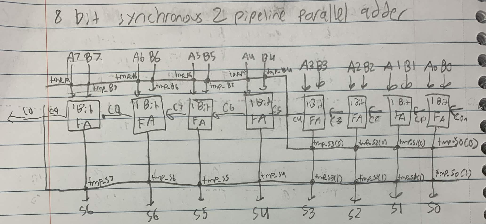
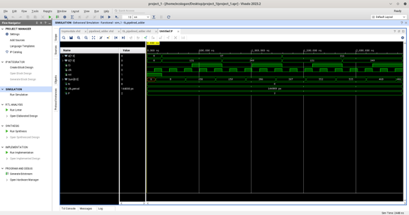
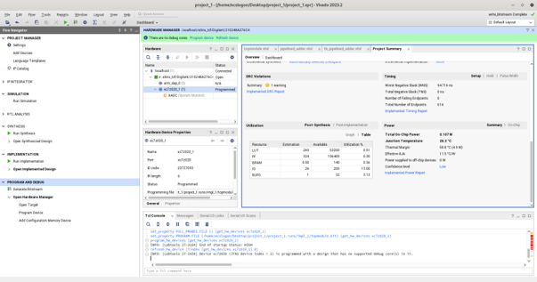
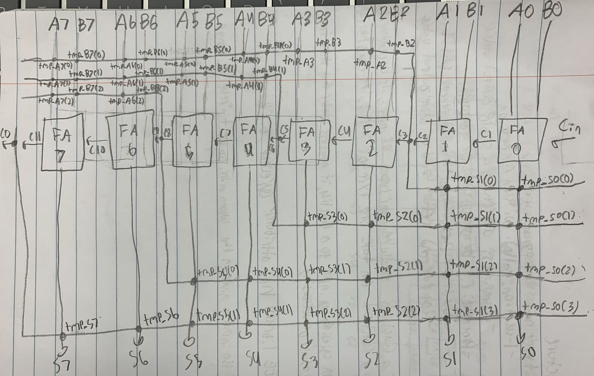
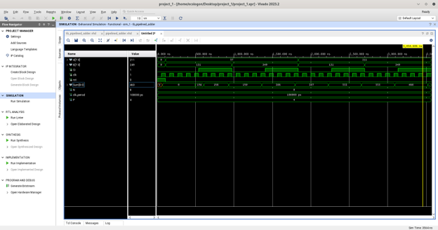
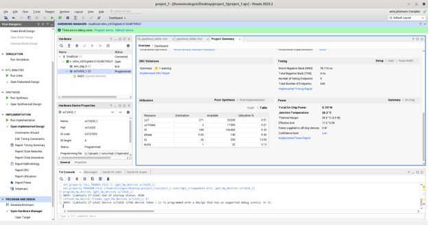

# 8 Bit Synchronous Pipelined Parallel Adder (VHDL)

## Overview
This project explores digital logic design tradeoffs between clock frequency, propagation delay, and hardware utilization by implementing 8 bit synchronous pipelined parallel adders in VHDL. Both 2 stage and 4 stage pipeline architectures were designed, simulated, and functionally verified using Xilinx Vivado, followed by synthesis and bitstream demonstration on a Xilinx ZedBoard FPGA.

## Key Performance Results
* **2 Stage Pipeline Architecture:** Divided into two 4 bit pipeline stages. Calculated minimum clock period = **144 ns**.
* **4 Stage Pipeline Architecture:** Divided into four 2 bit pipeline stages. Calculated minimum clock period = **108 ns**.
* **Performance Gain:** Increasing register density from 2 stages to 4 stages reduced critical path propagation delays, enabling a **25% reduction in minimum clock period** (higher system throughput).

---

## 1. Two Stage Pipeline Implementation

### Hardware Architecture Diagram
Hand drawn schematic detailing signal propagation and register placement across bit boundaries (Bits 0–3 in Stage 1, Bits 4–7 in Stage 2).

### Behavioral Simulation Waveform
Vivado output waveform validating functional correctness across all test vectors at a 144 ns clock period.

### Hardware & Utilization Report
Post synthesis resource utilization and timing summary generated in Vivado targeting the ZedBoard.

---

## 2. Four Stage Pipeline Implementation

### Hardware Architecture Diagram
Hardware schematic detailing register insertion every 2 full adder blocks (Bits 0–1, 2–3, 4–5, 6–7).

### Behavioral Simulation Waveform
Vivado output waveform verifying operation at an optimized clock period of 108 ns.

### Hardware & Utilization Report
Post synthesis hardware resource utilization and power summary.

